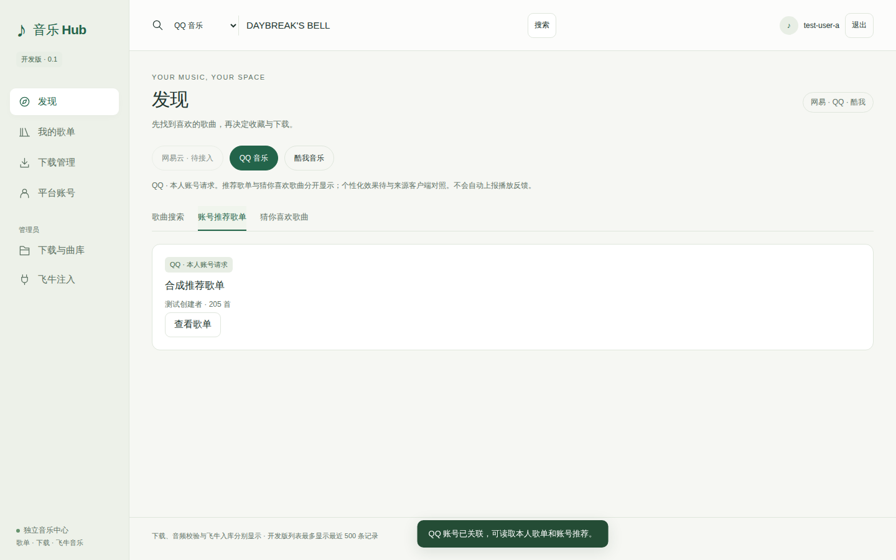
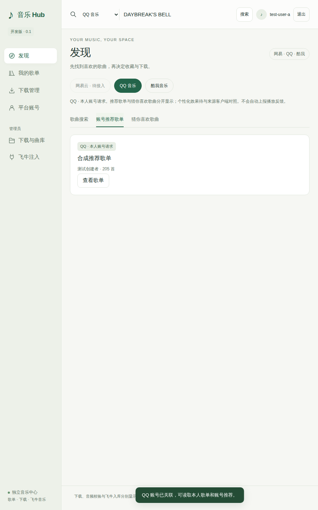
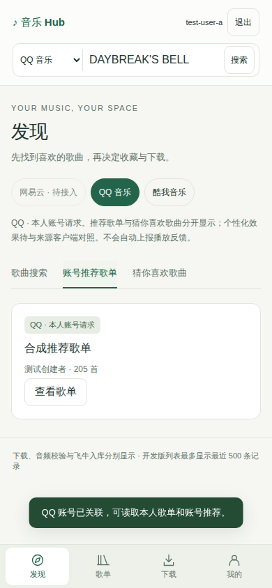
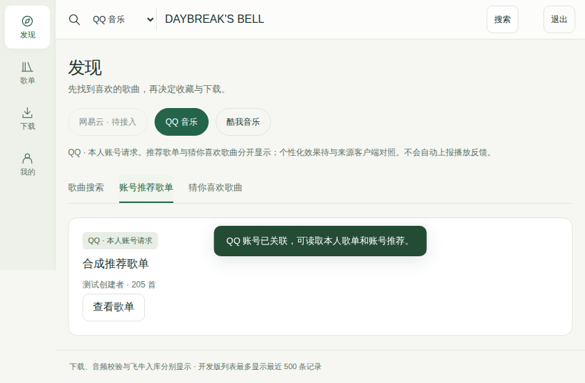

# 界面评审稿

## 2026-10-23 · 本地快照补齐

“我的歌单”增加“已保存快照”标签，始终按飞牛 owner 访问；本地历史支持更早记录、只读曲目、确认删除，QQ 未启用或解绑时仍可用。当前快照与旧历史合并，503 不清空实时预览和本地入口；绑定撤销仍清除实时账号内容。新增 1000 项滚动与十视口检查，实际运行结论见 [验证记录](VALIDATION.md)；真实设备验收独立。

## 2026-10-23：完整快照与分页共存

歌单详情增加生成、从头重试、回读已保存快照与只读曲目明细。状态明确显示两轮观测一致/未完成；不把分页页码改成快照页码，不更改选曲和下载确认，不启动 QQ 下载。旋转不重复请求，退出丢弃迟到结果。新增 jsdom 与十视口 Chromium 用例；实际运行结果见 [验证记录](VALIDATION.md)。

快照新增流程已通过提交 `c65242e` 的 [Actions 39945305983](https://github.com/Surc/fnos_music_hub/actions/runs/39945305983)，原下载确认与快照详情各自检查边界/关闭按钮。四种实际应用布局截图（合成 API）如下：

| 场景 | 完整快照明细 |
| --- | --- |
| PC 横屏 | [1440×900](qq-ui-screenshots/qq-snapshot-pc-landscape.png) |
| PC 竖屏 | [900×1440](qq-ui-screenshots/qq-snapshot-pc-portrait.png) |
| 手机竖屏 | [390×844，全页](qq-ui-screenshots/qq-snapshot-mobile-portrait.png) |
| 手机横屏 | [844×390，全页](qq-ui-screenshots/qq-snapshot-mobile-landscape.png) |

## 2026-10-22：QQ 业务页接入

Chromium 合成 API 下的实际页面截图与 [十视口报告](qq-ui-screenshots/browser-report.json) 已保存。截图不是来源平台私人歌单或真实扫码验收。

| PC 横屏 | PC 竖屏 |
| --- | --- |
|  |  |

| 手机竖屏 | 手机横屏 |
| --- | --- |
|  |  |

本轮在已授权布局中接入 QQ 扫码/核对/显式关联与解除、账号推荐歌单/猜你喜欢分栏、本人创建歌单及分页详情。关联由服务端代次保护，关闭弹层可继续原尝试；旋转不创建第二次扫码或绑定。猜你喜欢不是每日推荐；详情注明“分页预览，未验证整单完整性”，QQ 下载继续禁用。真实账号与手机设备验收另列，不用合成接口页面代替。

日期：2026-10-21；状态：**用户已授权实施，当前可用页面已落地**。运行前台已替换为响应式界面，使用真实会话、搜索、收藏、任务和资产 API；不包含原型中的示例歌单/账号/文件。推荐、私人平台账号、远端整单、入库和注入执行仍未交付，界面按实际能力标明未开放。

## 页面组织

沿用绿色风格，桌面左侧导航，手机适配同一套页面；顶部显示当前飞牛用户与搜索。私人数据跟随服务端身份，换用户需退出重登，不填写 user_id 代替认证。

| 入口 | 内容与关键操作 |
| --- | --- |
| 发现 | 网易/QQ/酷我切换；本人推荐歌单/每日推荐歌曲/公共热门分开，未绑定则提示，不用热门冒充私人推荐 |
| 我的歌单 | 本地收藏/本地歌单与平台订阅分开，标来源及所属账号；详情保序/重复/不可用项 |
| 下载管理 | “任务 / 已下载歌曲”标签；任务看进度/错误/暂停恢复，文件看实际质量/校验/位置/入库 |
| 平台账号 | 本人网易/QQ 绑定、失效、换号、解绑；酷我先公共模式，私人功能验证后开放 |
| 下载与曲库（管理员） | 下载允许目录、用户授权、飞牛库目标分别设置；普通用户只选授权目标 |
| 飞牛注入（管理员） | 独立开关、兼容/Socket 所有者/恢复；关闭不影响独立前台 |

## 关键流程

1. 发现→歌单详情→选曲→下载确认：确认来源、音质、授权目录和入库请求，提交不可变清单。不完整歌单不称整单成功。
2. 搜索结果保留歌曲，限制显示在任务和条目上。未准入的跨平台替代不显示可用。
3. “本地收藏”与“喜欢/订阅到平台”分别操作，后者指明本人账号；写入未知显示待核对。
4. 下载完成、音频校验、飞牛入库分别显示；后端不支持时明确未支持，不伪报成功。
5. 自动播放反馈默认关闭，可信客户端和平台验收后再开放；普通用户无管理员入口，后端同样检查权限。
6. 页面覆盖加载、空列表、未绑定/失效、无权限、地区限制、结果未知、未支持状态。

## PC / 移动端，横屏 / 竖屏

用户明确要求两端、两种方向均适配。采用同一套页面、权限与业务状态，根据可用宽高和交互方式重排；不锁定方向，不只用宽度把手机横屏判断成 PC。以下尺寸均为 CSS 视口测试样本，不是物理分辨率或设备白名单。

| 验收场景 | 参考视口 | 导航与内容布局 | 下载确认 / 设置页 |
| --- | --- | --- | --- |
| PC 横屏 | 1440×900、1920×1080 | 左侧完整文字导航；歌单多列、歌曲/任务紧凑列表，列数随可用宽度调整 | 居中弹层；音质、保存目录和入库选项清楚，管理员设置分组 |
| PC 竖屏 / 窄窗口 | 900×1440、1080×1920；另测窗口缩窄到 720 宽 | 保留导航入口，侧栏随空间收窄或折叠；歌单减少列数，长表按重要信息重排 | 弹层不超出窗口；设置标签/字段允许上下排列，不缩小文字硬塞 |
| 移动端竖屏 | 320×568、360×800、390×844、412×915 | 紧凑页头，主要导航为“发现 / 歌单 / 下载 / 我的”；平台账号和管理员设置从“我的”进入；歌单双列，歌曲/任务按行卡片 | 下载用底部面板或整页确认；授权目标按名称选择，普通用户不出现管理员操作 |
| 移动端横屏 | 844×390、915×412；另测 667×375 | 紧凑侧边导航与页头，减少顶部占用；歌单按剩余宽度多列，不占用一整行底栏 | 低高度优先整页/分栏确认，内容可纵向滚动，确认与关闭始终可达；不套用大桌面弹窗高度 |

共同要求：

- 旋转或调整窗口不重新登录、不重新请求云端写入；当前页面、来源、关键词、筛选、选曲、表单值和幂等键保留，不能因此重复创建下载任务。
- 所有页面都覆盖四种布局，包括登录、搜索、歌单详情、任务/文件、平台绑定、目录/曲库和独立注入设置；普通用户与管理员分别检查。
- 最小宽度 320 CSS px 不出现页面横向溢出；长英文歌名、错误、文件位置和多行操作不盖住按钮。重要信息可换行或展开，不依赖鼠标悬停才能操作。
- 手机主要触控目标至少约 44×44 CSS px，输入文字至少 16 CSS px；适配浏览器栏、刘海/手势安全区、软键盘和低高度视口。弹层正文可滚动，确认/关闭不能被裁切；PC 检查键盘与 200% 缩放。
- 旋转时打开的下载确认、账号绑定和错误详情仍可继续或关闭；后台任务不因布局变化暂停、重试或再次提交。

四种布局已用于当前可用页面。桌面完整侧栏、窄窗收窄侧栏、手机竖屏底部四入口、手机横屏紧凑侧栏、原生下载确认与详情弹层均已实现；窗口/可见视口变化只调整布局，不重建业务状态。自动浏览器检查使用合成 API，真实 NAS/手机软键盘和安全区仍按平台清单单独验收。

## 实施范围与后续验收

- 导航与下载页合并是否顺手，默认首页是否合适。
- 来源切换、公共/个人推荐、收藏/平台订阅是否清楚。
- 歌单详情、下载确认、错误展示、账号与独立注入设置的流程。
- 风格、信息密度和四种布局。已开始落地当前可用页，按 [功能清单](ACCEPTANCE_FUNCTIONS.md) F-UI-01 至 F-UI-06 和 [平台清单](ACCEPTANCE_PLATFORMS.md) Web 四种场景逐项验收。

实施结论：用户已要求实现，本轮落实可用页面与下载流程；后续新增歌单/推荐/平台绑定等业务页继续遵循以上布局与权限要求。

## 当前实现截图

以下由通过检查的 Chromium 运行生成，使用合成测试 API；界面结构是实际应用代码，不代表真实平台账号或下载成功。

| 场景 | 截图 |
| --- | --- |
| PC 横屏 | [1440×900](ui-screenshots/pc-landscape.png) |
| PC 竖屏 | [900×1440](ui-screenshots/pc-portrait.png) |
| 手机竖屏 | [390×844，全页](ui-screenshots/mobile-portrait.png) |
| 手机横屏 | [844×390，全页](ui-screenshots/mobile-landscape.png) |
| 手机横屏确认 | [844×390，下载确认](ui-screenshots/mobile-landscape-confirm.png) |
